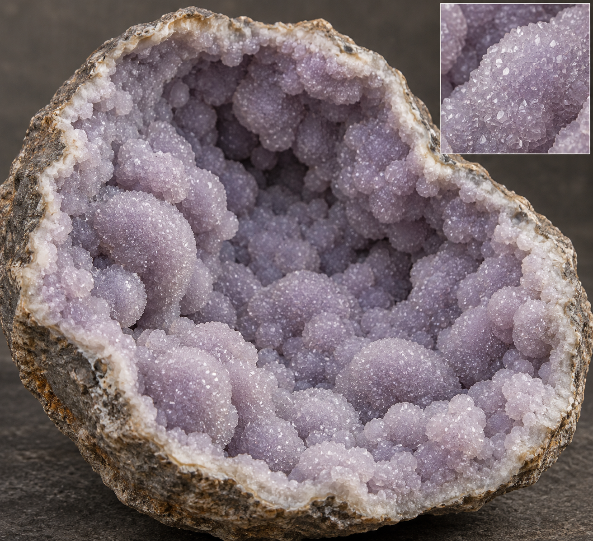
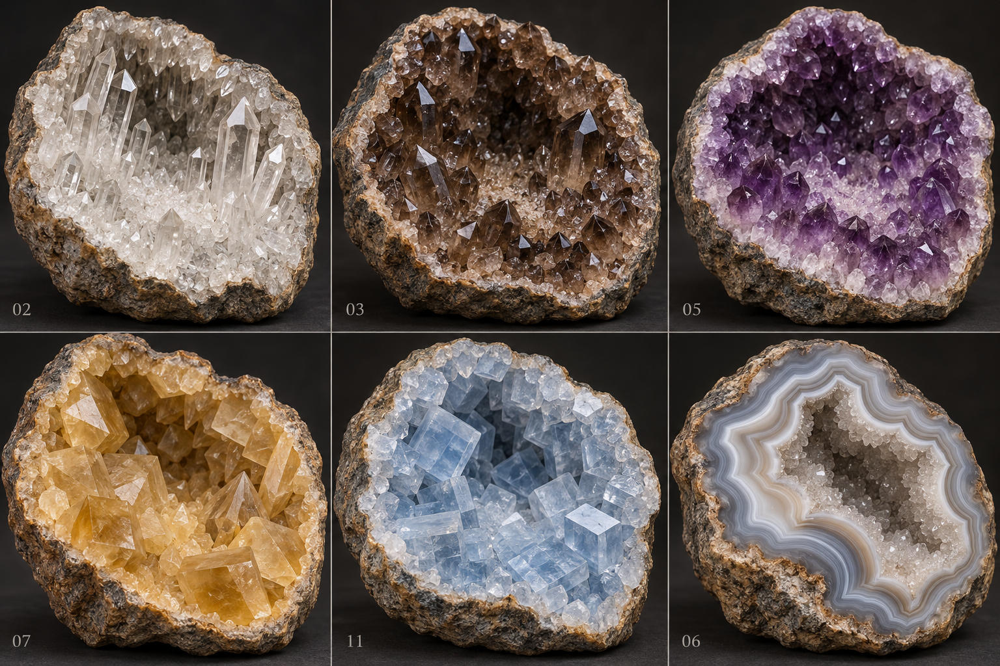

# 本轮内置 imagegen 图片与完整提示词

2026-10-30：先收集真实标本与形态文字，再使用内置 imagegen 生成两张独立方向图。没有使用 CLI、图转三维、外部模型或将照片直接作为游戏贴图。下图均为 AI 概念图，不是实际模型渲染。

## 葡萄状密集覆晶

保存文件：[09-grape-drusy-direction-v03.png](../prototype/assets/reference/09-grape-drusy-direction-v03.png)。



完整最终提示词：

```text
Use case: photorealistic-natural
Asset type: single art direction sheet, NOT a game screenshot or scientific source.
Primary request: A real-looking split geode half whose ENTIRE cavity is densely lined with intergrown botryoidal lavender quartz/chalcedony-like mineral formations carrying a fine crystalline drusy quartz skin.
Composition: one large specimen, front three-quarter view, on charcoal mineral studio surface, rough neutral gray-brown host shell, thin natural pale mineral transition. Include one discreet macro inset showing true angular microfacets on the rounded substrate, no text.
Coverage is essential: mineral lobes and fine crystalline skin cover ALL visible interior walls, back wall, CENTER and bottom continuously from rim to rim. The cavity is abundant and nearly filled by rolling interlocking mounds of varying sizes. Leave an irregular deep recess between the densely grown walls to communicate a hollow geode. No large bare smooth bowl areas anywhere. Many adjacent rounded lobes merge at their bases and into an undulating continuous surface; grape-like texture rather than separate detached balls.
Materials: subtly translucent gray-lavender and dusty lilac, tiny crystalline facets blanket the rounded surfaces producing a granular delicate drusy shimmer under directional light. Some smaller secondary nodules grow over larger intergrown lobes. Variation in size and density, geologic imperfection. Sharp tiny facet reflections without sparkle-star overlays, no luminous minerals.
Lighting: warm soft key and neutral fill, photographic mineral specimen macro quality.
Avoid: sparse isolated colonies, blank smooth plaster bowl, empty center surrounded only by a ring of balls, pearl necklace, plastic spheres, perfectly uniform beads, black honeycomb cracks, cartoon rock, neon purple, artificial diamond jewels, glitter particles or star stickers. Not a flat slice; show depth.
```

## 其他晶形对照

保存文件：[mineral-habits-direction-v01.png](../prototype/assets/reference/mineral-habits-direction-v01.png)。六幅为一张对照板，用于区分晶形。



完整最终提示词：

```text
Use case: photorealistic-natural. Asset type: ONE comparative mineral art direction contact sheet, NOT scientific evidence or a game screenshot. Six equal panels on charcoal studio background, each a cut natural rough geode half with ENTIRE inner walls and bottom covered by dense mineral growth and a remaining irregular central recess. Distinct realistic geometry, not recolored copies. Top row: (1) colorless hexagonal long quartz prisms with staggered length and sharp rhombohedral terminations on a fine crystal bed; (2) stout smoky brown translucent quartz points with varied sizes; (3) muted deep amethyst short dense quartz heads, pale bases. Bottom row: (4) honey calcite with oblique broad rhombohedral blocks and occasional dogtooth scalenohedra, NOT quartz hexagonal points; (5) pale blue celestine with thick tabular and orthorhombic rectangular prisms, flat broad facets NOT quartz; (6) gray-white agate with continuous gently wavy curved bands framing an irregular small drusy quartz recess, NOT paper layers. Warm directional light and neutral fill, rough gray brown hosts, subtle real facet reflections, no self emission, no star glitters, no jewelry diamonds, no cartoony models. Specimens occupy each panel comfortably with detail visible. Small numeric labels 02,03,05,07,11,06 only, no additional text.

Generated using the built-in imagegen tool on 2026-10-30. This is an AI art-direction contact sheet, not a photograph, scientific source or implemented 3D screenshot.
```

[真实照片与中文形态依据](MINERAL_DENSITY_REVISION.md) · [实际三维对比，不是上面图片](../tests/grape-density-review.html)
