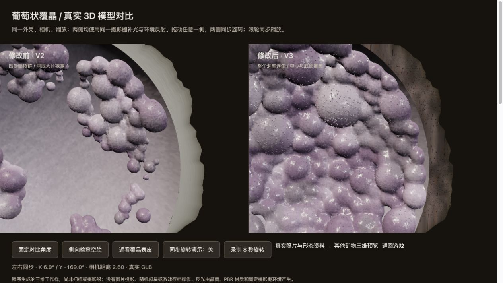
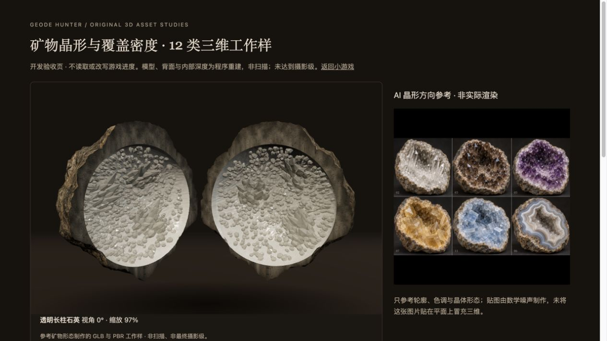
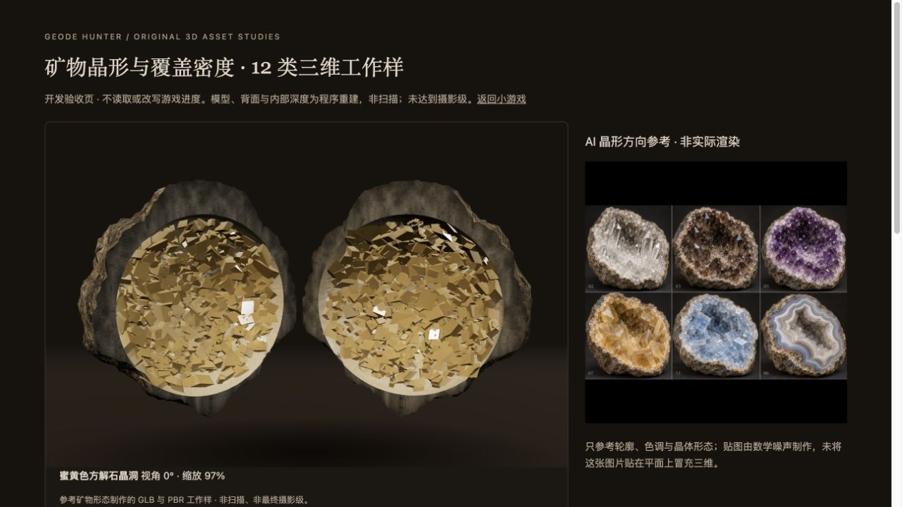
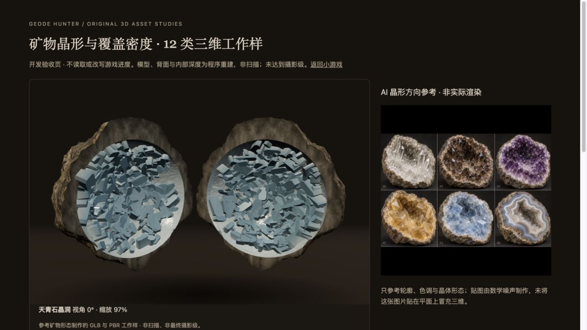
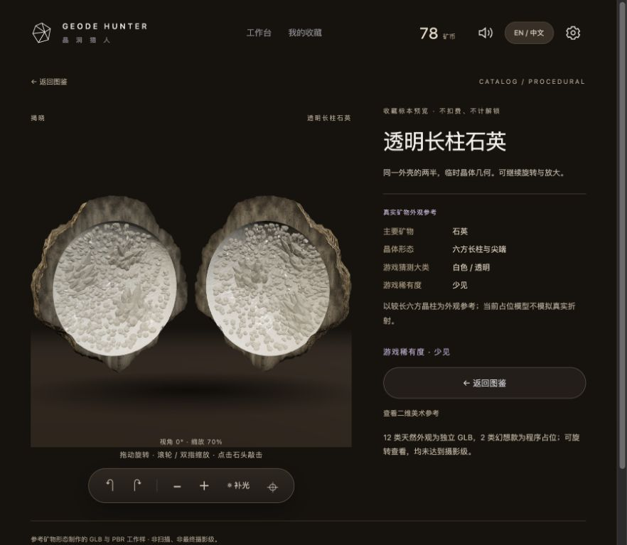

# 晶洞内壁覆盖修订 · 2026-10-30

## 真实参考先于生成
用户指出 V2 葡萄状模型只有四处结核群，洞底大片裸露。该反馈成立：`nodules()` 主动排除了中心半径 0.36 内区域；这项布局错误与表皮是否有细闪是两个不同问题。V2 文件与证据保留，不改写为已获认可。

本次目标是**整个可见洞壁、洞底和后壁连续铺满矿物生长，结核密集连生，仍留下不规则、较深的观赏空腔**。不是少量球体装饰空碗，也不是填成没有空腔的实心球。覆盖密度是本项目选择的标本类型，不代表所有天然晶洞均必须满铺。

### 可查看的真实照片与文字来源
- [Zone Minérale：马拉维葡萄状细闪玛瑙晶洞](https://www.zoneminerale.com/product-page/stunning-sparkly-blue-lace-agate-geode-botryoidal-druzy-malawi)：卖家的实际标本说明提到洞壁为葡萄状起伏，其上完整覆盖微小石英晶簇。用于密度和表皮参考；不转载其版权照片。
- [Rob Lavinsky / iRocks：墨西哥葡萄状玉髓晶洞](https://commons.wikimedia.org/wiki/File:Quartz-46809.jpg)：观察圆丘之间的连生关系、整片内壁的矿物覆盖及天然洞口。原照不是紫色细闪款，不能当成后者的完整证明。原图已按 CC BY-SA 3.0 原样收录在 `prototype/assets/research/`，署名与许可见 sources.json。
- [石英晶形，Handbook of Mineralogy](https://handbookofmineralogy.org/pdfs/quartz.pdf)：六方外形晶柱、菱面体终端、晶簇或细晶覆盖。
- [方解石晶形，Handbook of Mineralogy](https://handbookofmineralogy.org/pdfs/calcite.pdf)：菱面体、偏三角面体、板状等多种晶习；本项目选择块状菱面体及犬牙状组合。
- [天青石晶形，Handbook of Mineralogy](https://handbookofmineralogy.org/pdfs/celestine.pdf)：斜方晶系，板状、叶片状到柱状，浅蓝且有玻璃光泽。
- [方解石与紫水晶实物](https://commons.wikimedia.org/wiki/File:Calcite-Quartz-118317.jpg)：大块方解石与细小石英形成两种形态，不是整洞同一种尖锥。
- [天青石、方解石共生实物](https://commons.wikimedia.org/wiki/File:Celestine-Calcite-Rhodochrosite-244357.jpg)：仅作为板片与菱面体晶形参考，不把这件共生标本声称为本项目产区。

### 可用于建模的中文形态描述
| 品种 | 表面与生长描述 | 此次几何方向 |
|---|---|---|
| 白晶细闪 | 连贯浅色细晶底，局部短晶簇 | 保留已单独修订的 V2，不回退为密集碎石 |
| 透明长柱 | 六方侧面可辨，柱长有梯度，尖端互相错落 | 密集短底晶搭配几群较长晶柱 |
| 烟晶 | 灰褐半透明石英，粗短柱与较长柱交错 | 粗柱、不同尺寸和倾角，避免黑色空隙 |
| 浅紫 | 浅色根部、较淡紫晶端，细密石英簇 | 较小较短晶簇覆盖内壁 |
| 深紫 | 密集较粗晶头，深紫端部与浅色根部 | 粗短柱与多个菱面终端，非荧光发光 |
| 玛瑙条带 | 沿空腔轮廓弯曲的灰白半透明条带 | 较厚连续条带与小型内侧细晶，不是叠纸片 |
| 蜜黄方解石 | 暖蜜色玻璃光泽，斜切菱面和犬牙晶形 | 菱面块体与少量尖长犬牙 |
| 白方解石 | 奶白半透明，宽平斜切晶面 | 互生菱面体，避免六方石英同模换色 |
| 葡萄状 | 圆丘大小交错并互相融合，整片洞壁连生，极细石英晶皮细闪 | 中心、后壁、底部均覆盖，连续体表皮附着小晶面 |
| 黑矿共生 | 深色晶体嵌于浅色石英底，不是整洞漆黑 | 密集浅色石英与成束深色柱体组合 |
| 天青石 | 浅灰蓝板柱，宽平晶面，斜方外形 | 片柱状与长方截面，未来品种仅图鉴预览 |
| 石英与方解石 | 细石英晶床上长出较大菱面方解石 | 两类独立几何与材质 |

## 图像、三维与验证的边界
真实标本照片是研究材料。AI 方向图是目标概念，不是实物照片或模型渲染。游戏里的 GLB 是原创程序生成的三维工作样，不是扫描，不承诺摄影级复原。两款幻想隐藏款保持原状，不把幻想规则当矿物学。实际运行检查与截图将在下方另行追加。

## 实际实现与检查

### 葡萄状 V3
- 左右半壳分别有 268 / 266 个大小不同的连生结核，细晶几何 5,444 / 5,510 个。结核布满整个洞底和内壁，不再排除中心。相交结核由连续标量场融合，不是独立球体叠放。
- 第一轮满铺出现横排规律，实际浏览器看出后改为随机错位、大小变化、再补足未覆盖区域；没有把第一轮失败渲染标为已完成。
- 表皮细晶附着于融合主体的实际三角形表面。细闪来自棱面、PBR 与固定摄影棚反射，无随机闪星；外缘改为中性岩石色和面状纹理坐标，减轻白色塑料厚环与同心层纹。
- 新资产：`botryoidal-chalcedony-study-v3.glb`，约 35 MiB。V1、V2 原资产、提示词、截图与录像保留。

### 其他十类天然外观
已分别生成并接入独立配对 GLB：透明长柱、烟晶、浅紫、深紫、玛瑙、蜜黄方解石、白方解石、黑矿共生、天青石、石英与方解石共生。石英使用六方柱体；方解石使用斜切菱面块与犬牙体；天青石使用有厚度的板柱；共生类型组合两套形态；玛瑙为连续波状条带与较小细晶空腔。不是同一模型改色。

晶体沿弯曲内壁向空腔生长并加入独立倾角。透明长柱集中形成几组较大的晶簇，周边短晶铺底，避免全洞长柱汇成星芒。部分玻璃材质启用 glTF transmission / volume，但这不等于准确的多次折射。内壁有近似顶点暗化来辅助深度，不是物理光线追踪或实物遮蔽扫描。

实际检查中发现天青石初版顶盖绕序反了，正面像纸片；已修复端面、加厚板柱，并加入封闭流形和外向端面检查。白晶保留之前的 V2；两款幻想占位保留；天青石仍不进入初始批次。

### 复现
```sh
# 只重建当前的新工作样；不需要 npm。Node 仅用于重建，游戏运行仍只需静态服务。
node tools/build-grape-drusy-v3.mjs
node tools/build-mineral-habits-v2.mjs
node --test tests/*.test.mjs
python3 -m http.server 8773 --bind 127.0.0.1
```
打开 `/tests/mineral-research.html` 看真实图片、中文形态说明与 AI 方向图；`/tests/grape-density-review.html` 为 V2/V3 同镜头实际模型对比；`/tests/reference-models.html` 可逐类旋转/缩放与四击。开发验收页不读取或改写玩家进度，也不伪造收藏解锁。

### 本轮实际验证（2026-10-30）
- `node --test tests/*.test.mjs`：**24 项全部通过**。包含原游戏经济、固定结果、存档重放、Game Over / Complete；12 类 GLB 配对壳体/PNG/索引/浮点检查；旧模型哈希保留。
- 新覆盖检查投射实际结核三角形，在内壁中心及椭圆半径 0.87 范围采样，要求覆盖率大于 97%、中心大于 98%；对 V2 反例还确认中心覆盖低于 30%，避免仅靠结核数量假通过。此采样不声称证明所有切线角度都没有空隙。
- 浏览器逐一载入并揭晓 12 类正确路径，12 张实际 GLB 图鉴缩略图全部正常（像素比 2 时自然宽度 960）；未捕获 warn/error。
- 实际鼠标点击完整石头四次，界面依次显示 1/2/3/4，第四次显示双半壳。葡萄对比页实际拖动从 X 6.9° / Y -169.0° 到 X 18.3° / Y -139.7°，同相机距离 5.60；可继续自由旋转并缩放近看。
- 正式游戏刷新后仍为第 3 批、78 矿币、2 个已领取记录，19 号原石已揭晓待领奖；本轮没有代付费、领奖、重开或修改永久解锁。正式游戏收藏详情确认使用透明长柱 V2，中文→英文→中文切换时路径不变，余额保持 78。
- 本轮没有重新浏览器通关 25 颗；这部分由保留的游戏逻辑回归检查覆盖。没有另一位参与者试玩记录。

### 实际渲染证据（不是 AI 图）









## 尚未达到的目标
这些是结构与形态工作样。透光、内含物、精细蚀刻、真实接触遮蔽、外壳切口厚度、局部生长自然度与微晶质感仍明显低于实物照片及 AI 方向图；部分晶体仍偏硬、偏规则，葡萄表皮仍有颗粒感。摄影级美术未通过作者确认。新 GLB 单文件约 7–35 MiB，尚未做压缩、低面数层级或低端设备长时性能验证；实体触屏和扬声器听感未在本轮验收。下一步应先确认各品种实际观感，再采用正式模型/纹理或逐类继续精修。


[内置 imagegen 两张方向图、保存文件与完整最终提示词](ART_DIRECTION_PROMPTS.md)
