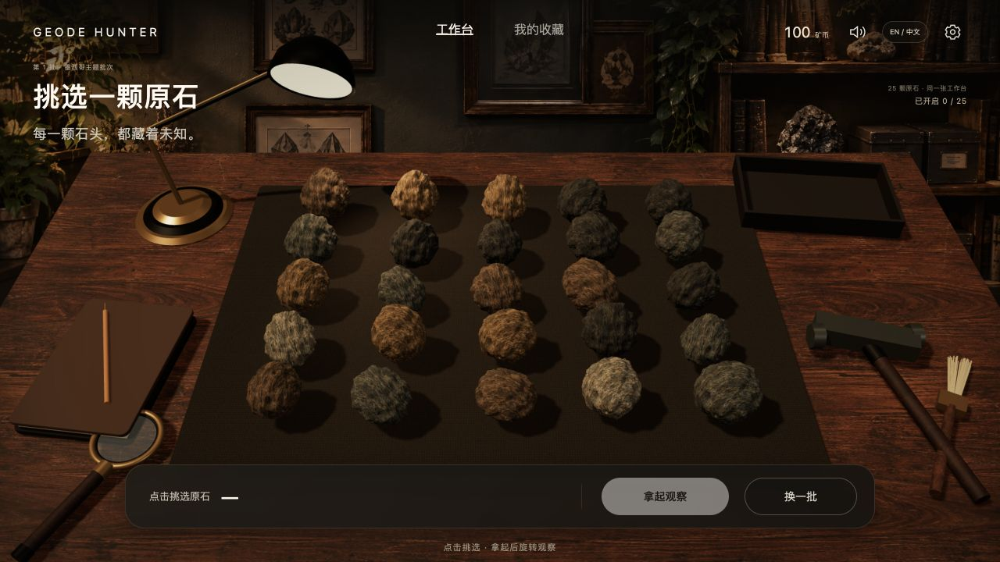
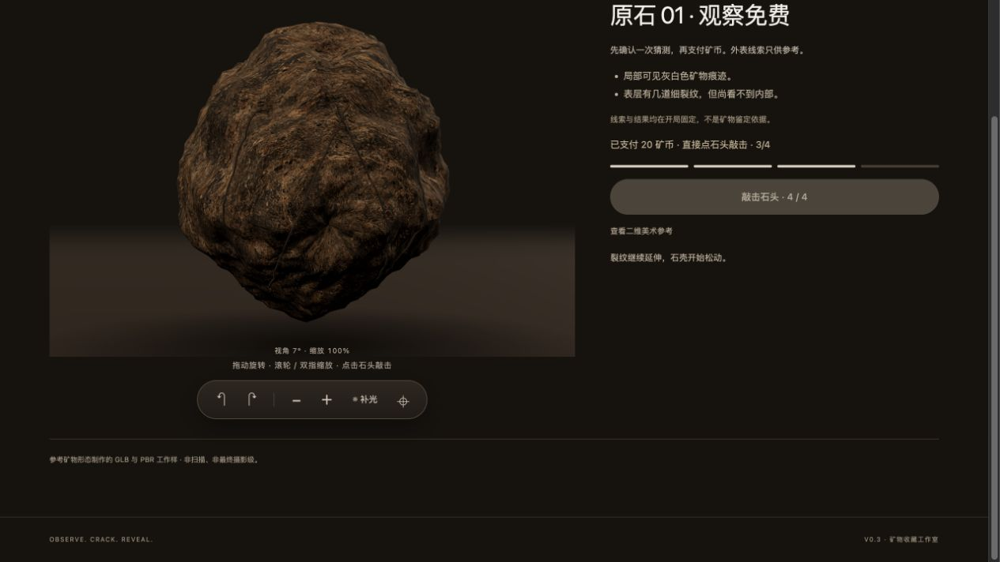

# 发给朋友的试玩入口

**https://lumina611.github.io/Geode-Hunter/**

这是 GitHub Pages 公开试玩版。无需下载项目、安装 VS Code、打开终端或启动 Python；建议先用电脑浏览器。首次载入模型可能稍慢。每个人的进度保存在各自浏览器里。

代码及作业提交仓库：https://github.com/Lumina611/Geode-Hunter

## 可转发给朋友的话

这是我的编程课小游戏《晶洞猎人》：https://lumina611.github.io/Geode-Hunter/

请先自己试几分钟，我先不讲操作。玩完告诉我：你首先尝试了什么？哪里看不懂或犹豫？是否明白开石后的奖励和怎么重新开始？哪一处最想修改？不用提供姓名或录音。

## 已收到的第一轮反馈

作者已转述一位朋友自行上手、未报告卡点的反馈；建议增加品种、科普及虚拟矿币途径。本轮优先加入科普，记录边界及回应见 [USER_TRIAL_01.md](USER_TRIAL_01.md)。新增内容尚未复试。

## 后续试玩反馈模板

- 日期与设备：待填写。
- 对方首先尝试的操作：待实际观察。
- 犹豫、误操作或理解困难：待实际观察。
- 是否理解回应及下一步：待实际观察。
- 据此作出的改动，或维持原设计的理由：待填写。

真实结果应写进 PROCESS.md。以下开发者/AI 检查不替代另一位参与者试玩，不能预填成用户试用。

## 发布检查 · 2026-11-01

作者明确授权后，通过 GitHub 网站启用 Pages，来源为 main / 根目录，HTTPS。GitHub 显示 Your site is live。首轮部署记录：https://github.com/Lumina611/Geode-Hunter/actions/runs/41236185823 。

根 index.html 将试玩地址转到 prototype/index.html。脚本、模型与纹理使用项目内相对路径；新增 .nojekyll，后续部署直接保留静态文件路径。文件修改通过 GitHub Desktop 提交并同步。

发布前运行 node --test tests/*.test.mjs，24 项通过。公网实测：25 颗原石正常显示；01 号进入免费观察，载入 banded-agate-study-v2.glb；拖动视角约 340°→7°，仍为 0/4；确认白色/透明猜测，支付 20，余额 100→80；实际点石头四次，揭晓玛瑙（其他类），错误猜测奖励 8+0+10=18；领取后余额 98。返回显示已开 1/25，语言切换和刷新后仍为 98 / 已开 1/25。未捕获 warn/error。

没有在公网重新通关全部 25 颗；结算和经济边界由保留的回归检查覆盖。实体触屏和低端设备长时表现未在本轮验收。模型仍为程序三维工作样，非摄影级成品。

