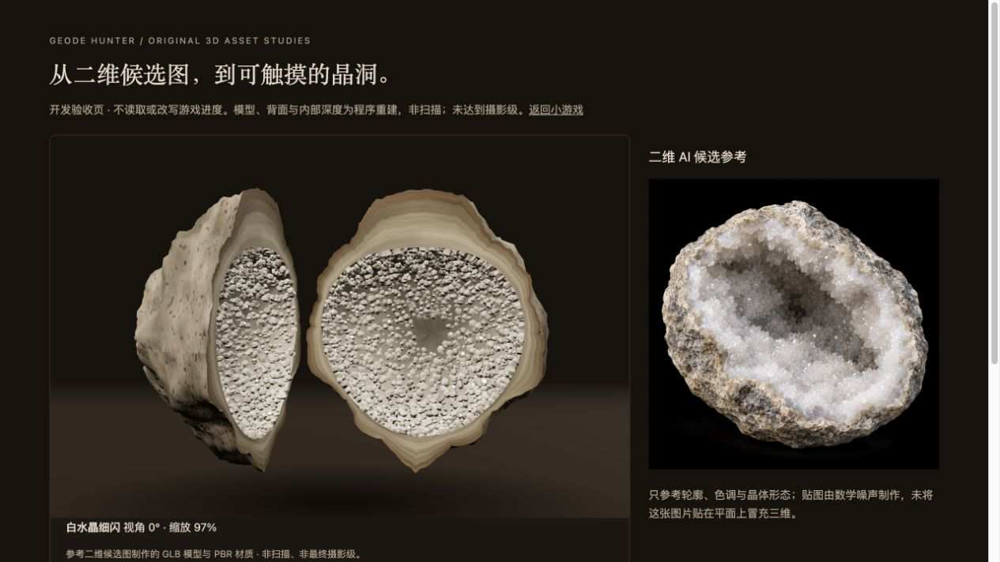
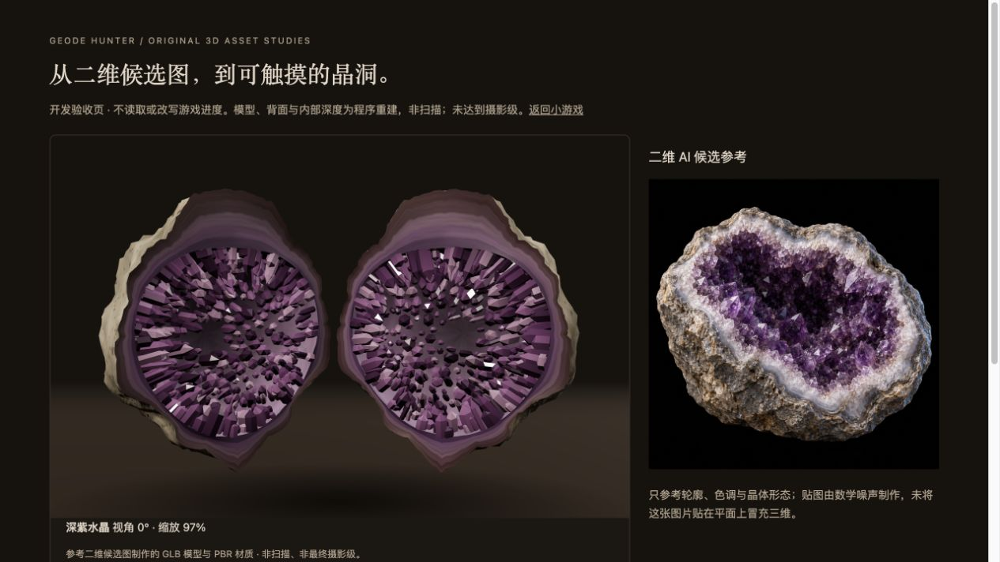
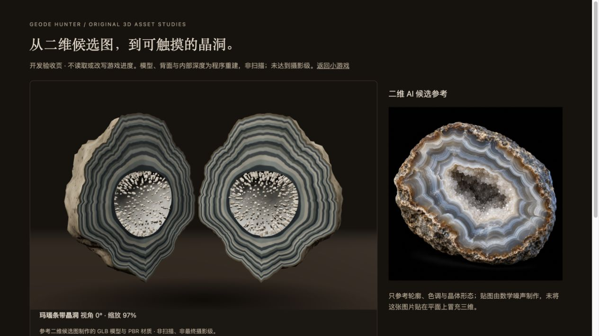
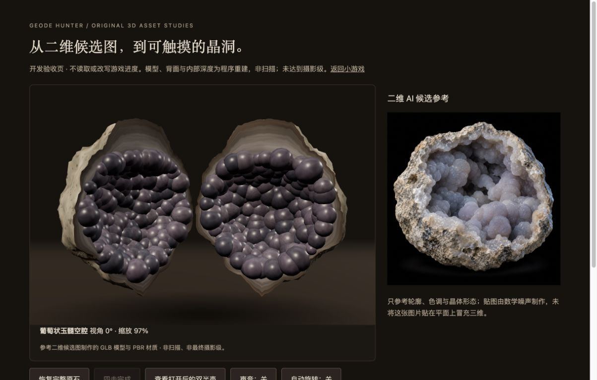
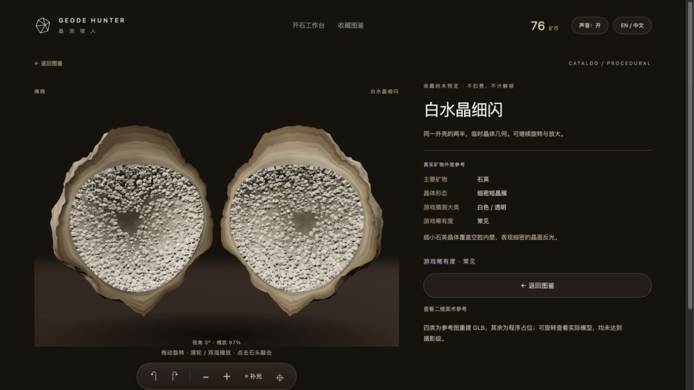
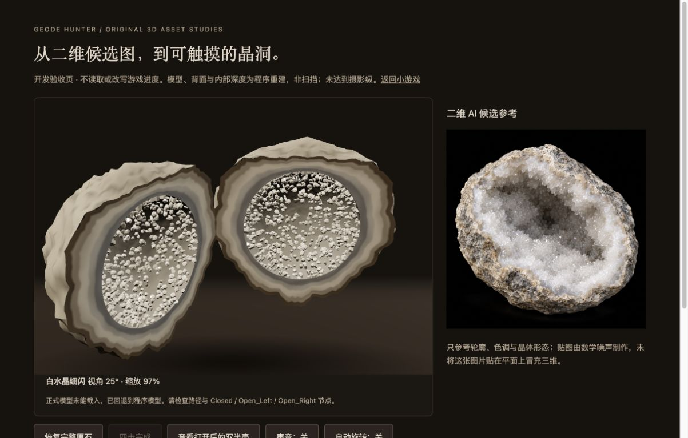
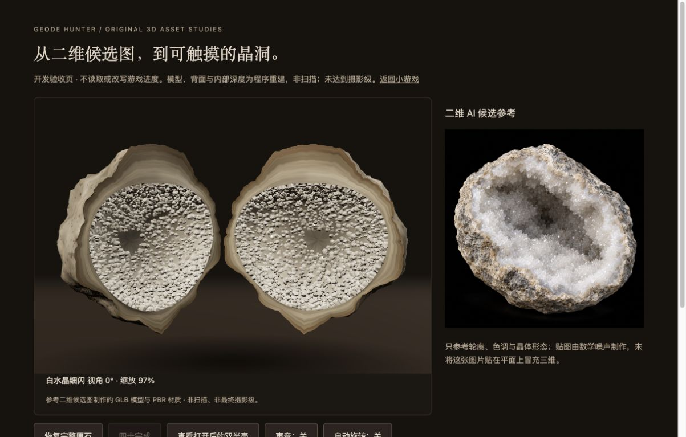

> 2026-10-30 当前状态：12 类天然外观已接入独立 GLB；葡萄 V3 满铺内壁，白晶保留 V2，其他十类已按晶习调整。仍非摄影级。以下保留历史阶段原文；当前文件与验证见 [最新修订](MINERAL_DENSITY_REVISION.md)。

> 后续工作台增补：运行时外壳现使用统一的 AI 颜色贴图与按外壳/种子处理；GLB 内的原程序贴图仍保留。下面记录的是前一轮独立模型工作样。[当前场景、素材与实际测试](WORKSHOP_ASSETS.md)。

# 参考图建模与材质工作样 · 2026-10-29

作者提供四张 AI 二维候选图，并要求根据它们制作材质和模型。本轮交付的是原创程序重建的三维资产，已经接入 V0.3；没有把二维图贴在平面上模拟旋转，没有从单图恢复真实几何，也没有使用实物扫描。

## 查看和文件

按 README 启动本地服务后，打开 [四种模型工作样](http://127.0.0.1:8773/tests/reference-models.html)。本页独立于游戏局次，不读取或改写游戏进度。点击下方品种，再点石头四次或「查看打开后的双半壳」。拖动旋转、滚轮缩放。右侧明确单独显示二维 AI 参考。

| 品种 | 实际 GLB 文件 | 内部结构 |
| --- | --- | --- |
| 白水晶细闪 | [white-druse-study-v1.glb](../prototype/assets/models/white-druse-study-v1.glb) | 每半壳 1700 个短六方晶体，尺寸与朝向变化 |
| 深紫水晶 | [deep-amethyst-study-v1.glb](../prototype/assets/models/deep-amethyst-study-v1.glb) | 每半壳 410 个较粗晶柱，分层浅色矿带 |
| 玛瑙条带 | [banded-agate-study-v1.glb](../prototype/assets/models/banded-agate-study-v1.glb) | 变宽波状矿带、小空腔与 390 个细晶体 |
| 葡萄状玉髓 | [botryoidal-chalcedony-study-v1.glb](../prototype/assets/models/botryoidal-chalcedony-study-v1.glb) | 每半壳 215 个不同大小的圆润集合体，颗粒法线与较高粗糙度 |

模型资源在 `prototype/assets/models/`。每个 GLB 具备 `Closed`、`Open_Left`、`Open_Right` 三个节点，封闭状态与打开半壳共用相同的外表几何。当前四类刻意共用中性的外壳轮廓，避免在开石前直接识别内部类别；不同石头保留游戏已有的位置、尺度和朝向，并按固定种子额外生成轻微三轴伸缩；工作台、观察、图鉴使用同一伸缩参数。正式外部导入不强加这种变形。每类内部结构不同，不是统一形状换色。

GLB 是供游戏切换三种表示的资产包；在独立建模软件里导入时，需隐藏 `Closed` 或两组 `Open_*`，避免同时显示重叠表示。游戏会自动处理可见性和开合转向。局部坐标的切面为 z=0，右半壳闭合时绕 y 轴转 π；`openRotationY` 控制揭晓转向。

`prototype/assets/textures/` 包含 15 张独立 PNG：一套公共风化外壳和四套内壁，各有 **Base Color、Normal、Roughness**，分辨率均为 512×512。原始纹理由数学噪声生成，可平铺；GLB 内还嵌入对应 PNG，浏览器无需另下载贴图文件。晶体使用非金属 PBR 参数；玉髓也使用颗粒法线和颜色贴图。没有真正的位移贴图、扫描微表面、准确折射或高精度遮蔽烘焙。空腔与晶体根部使用近似顶点暗化，改善深度感，不能视为真实光照模拟。

四张二维候选及原说明保存在 `prototype/assets/reference/`，原输入目录没有修改或删除。图片不是摄影、模型贴图或鉴定资料。背面、半壳厚度和未显示的空间由程序补全，没有从图片推断真实尺寸或产地。

## 重建和替换

运行时只需 Python 静态服务和浏览器。重新生成资产才需要 Node（项目已有本地 Three.js，无 npm 安装步骤）：

```sh
node tools/build-reference-models.mjs
node --test tests/*.test.mjs
```

生成器原文、结构与尺寸统计一并保留：[生成器](../tools/build-reference-models.mjs)、[构建清单](../prototype/assets/models/build-manifest.json)。重新运行会更新本轮生成的工作样，原二维输入不变。

四类在 `config.js` 的 art 配置中启用 `modelUrl`、`detailImage`、`modelStatus:'reference-study'`、`openRotationY`；正式模型可使用相同配对节点替换。表格、观察与图鉴使用同一资源解析器；图鉴缩略图来自实际 GLB 渲染，二维候选只在独立参考对话框显示。其余十类继续保留原程序占位。

## 本轮实际测试

- Node 共 **16 组通过**：保留原游戏经济、固定结果、旧存档与结算测试；新增检查四个 GLB 结构、PNG 嵌入、浮点有效性、索引范围、模型配对与闭合外壳一致性。
- 浏览器四种 GLB 均加载，四张实际三维渲染缩略图均有有效尺寸；最初正常工作样与游戏检查没有捕获到 warn/error。最后刷新旧页又暴露出模块缓存混用导致 `referenceScale` 缺失；已加依赖版本并实际刷新恢复，过程与修复提交保留，未隐藏这个失败。
- 白晶实测点击石头产生第一击，拖动从约 340° 转到 35° 且敲击数仍为 1；滚轮缩放到约 167%；继续到第四击后双半壳揭晓。另三类分别切换、打开并保存真实截图。
- 正式游戏共享工作台报告资源 `configured`；图鉴白晶加载 `reference-study` GLB。二维参考对话框与实际模型分开；中英文切换后模型路径与余额均未改变。本轮游戏内只做观察/图鉴检查，没有替用户支付、领取奖励或重新开始。
- 缺失文件分支：验收页加 `?missing=1`，故意请求不存在的本地 GLB。实际出现回退提示，原程序模型仍可完成四击揭晓；该页的 404 与 fallback 警告是预期测试结果。失败缓存会清除，恢复文件后可重新进入重试。没有删除任何真实模型来测试。
- 本轮没有重新浏览器通关全部 25 颗；游戏逻辑回归由自动测试覆盖，之前 V0.3 浏览器记录仍保留。不是另一位参与者的无讲解试用。

## 仍存在的差距

粗壳仍偏平滑、矿带重复感明显、晶体生长偏规则，玉髓团簇是球状近似；白晶尚无准确透明度与折射，细节远低于二维参考。模型约 6–12 MB/种，未经网格压缩或移动端 LOD 优化；低端手机、实体触屏、长时间性能、独立 DCC 导入编辑和听觉品质未专项验收。正式摄影级资产和用户美术确认仍待后续，不能把本轮工作样改称为扫描级或最终美术。









